<p align="center">
  
</p>

<p align="center">
  <strong>흩어진 뷰티샵의 빈자리와 할인을, 한곳에서.</strong><br />
  원하는 지역과 시간의 빈자리를 비교하고, 예약금 결제부터 방문까지 연결하는 뷰티 예약 플랫폼
</p>

<p align="center">
  
  
  
  
  
</p>

<p align="center">
  <a href="#서비스-소개">서비스 소개</a> ·
  <a href="#주요-기능">주요 기능</a> ·
  <a href="#영상으로-보는-주요-기능">기능 시연</a> ·
  <a href="#팀원과-담당-업무">팀원 소개</a> ·
  <a href="#시스템-구성">시스템 구성</a> ·
  <a href="#테스트와-검증">테스트</a> ·
  <a href="#로컬-실행">로컬 실행</a>
</p>

> **프로젝트 기록** · U-CAMP 2조 / 6인 풀스택 팀 / 2026.10.19 ~ 2026.11.05 개발, 11.06 발표  
> 발표 후 AWS 리소스를 정리하여 현재 공개 배포는 종료되었습니다. 아래 구성도와 배포 설명은 프로젝트 운영 당시 기준입니다.

## 서비스 소개

**땡잡은 언니**는 고객에게는 원하는 시간의 뷰티 예약을, 매장에는 비어 있는 시간을 다시 채울 기회를 제공합니다.

- **고객의 고민** — 여러 매장을 따로 확인하지 않고, 원하는 지역·시간·가격에 맞는 빈자리를 찾고 싶어요.
- **매장의 고민** — 갑작스러운 취소나 마감이 임박한 시간도 새로운 손님으로 채우고 싶어요.
- **우리의 연결** — 빈자리 탐색 → 시술 선택 → 예약금 결제 → 예약 확정. 원하는 자리가 없다면 관심 조건에 맞는 알림을 받습니다.

헤어·속눈썹·네일·피부 관리·메이크업을 대상으로, **일반 시술과 초보 시술 모집**을 함께 다룹니다.


## 주요 기능

### 고객 — 원하는 빈자리를 발견하고 예약하기

| 기능 | 제공 내용 |
| --- | --- |
| 회원가입·로그인 | JWT 인증, 고객·매장·관리자 역할에 따른 접근 제어 |
| 빈자리 탐색 | 지역·날짜·시간·가격 등의 조건으로 예약 가능한 시술 검색 |
| 지도 탐색 | 카카오맵으로 위치를 확인하고 거리와 매장 정보를 비교 |
| 매장·시술 상세 | 매장 소개, 이미지, 위치, 시술 가격과 소요 시간, 예약 가능 시간 확인 |
| 초보 시술 모집 | 일반 시술과 구분된 모집 정보 및 촬영 동의 절차 |
| 예약·대기열 | 같은 빈자리의 예약 순서 안내, 차례에 따른 임시 점유 및 결제 진행 |
| 예약금 결제 | 포트원 연동, 서버 측 결제 검증 후 예약 확정 |
| 예약 취소·환불 | 취소 전 환불 견적 확인, 취소 정책에 따른 환불 처리 |
| 마이페이지 | 내 예약 조회, 회원 정보 관리, 매장 찜 및 알림 관리 |
| 빈자리 알림 | 관심 매장·조건에 맞는 임박·초임박·취소 재공개 알림, 문자 및 SSE 연동 |

<details>
<summary><strong>고객 이용 흐름 펼쳐보기</strong></summary>

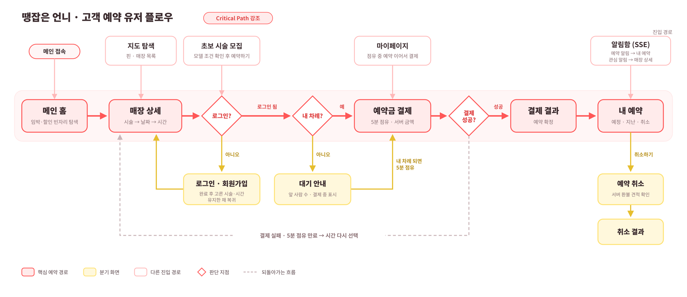

</details>

### 매장 — 빈 시간을 열고 예약을 관리하기

| 기능 | 제공 내용 |
| --- | --- |
| 매장 가입·검증 | 사업자 정보 검증 및 관리자 승인 절차 |
| 매장·시술 관리 | 매장 정보, 일반·초보 시술, 가격, 대표 이미지 등록·수정 |
| 영업시간 관리 | 요일별 영업시간·휴무, 특정 날짜·시간의 열기·닫기 설정 |
| 가용 시간·가격 | 영업시간과 예약 상태를 반영한 가용 시간, 임박 여부에 따른 가격 계산 |
| 예약·고객 관리 | 예약 현황과 방문 고객 조회, 예약 상태 관리 |
| 매장 취소 | 매장 사유·고객 요청을 구분한 취소와 환불, 필요 시 취소 시간 닫기 |
| 대시보드 | 매장의 예약·운영 현황 확인 |
| 빈자리 재공개 | 취소 이후 조건을 충족하는 시간을 다시 공개하고 관심 고객에게 알림 |

<details>
<summary><strong>매장 운영 흐름 펼쳐보기</strong></summary>

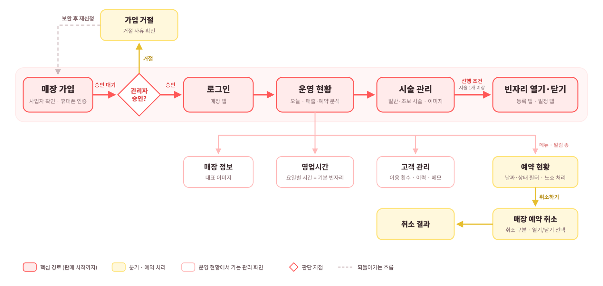

</details>

### 관리자 — 입점 신청 관리

매장 가입 신청을 조회하고 승인·거절합니다. 처리 결과는 신청 매장에 알림으로 전달합니다.

## 영상으로 보는 주요 기능

실제 시연 영상에서 핵심 구간을 발췌했습니다. GIF는 무음·반복 재생되며, 대기 구간을 줄이기 위해 일부 구간을 생략하거나 배속했습니다. 재생 속도는 실제 응답 시간 측정값이 아닙니다.

### 화면으로 둘러보기

<table>
  <tr>
    <th width="50%">지역·지도 기반 빈자리 탐색</th>
    <th width="50%">매장 운영 대시보드</th>
  </tr>
  <tr>
    <td>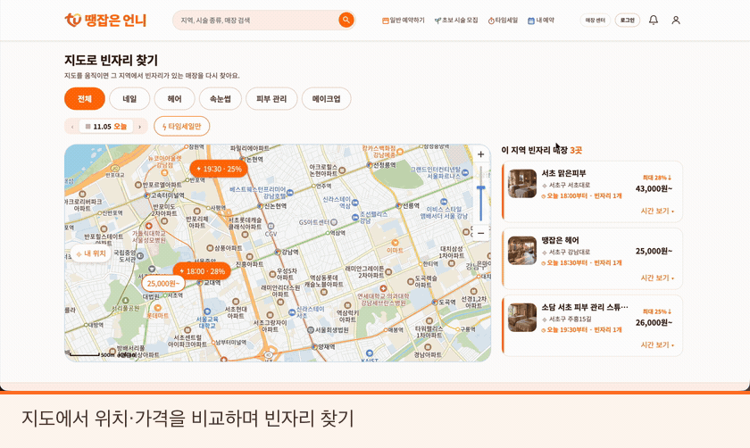</td>
    <td>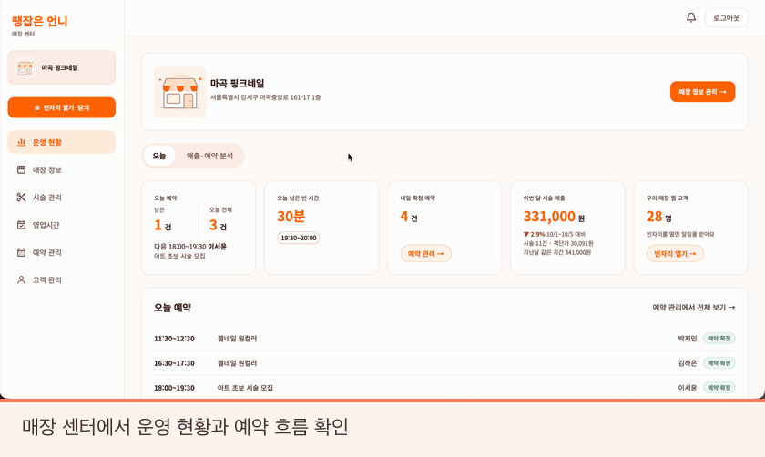</td>
  </tr>
  <tr>
    <th>시술·가격 등록</th>
    <th>예약금 결제·예약 확정</th>
  </tr>
  <tr>
    <td>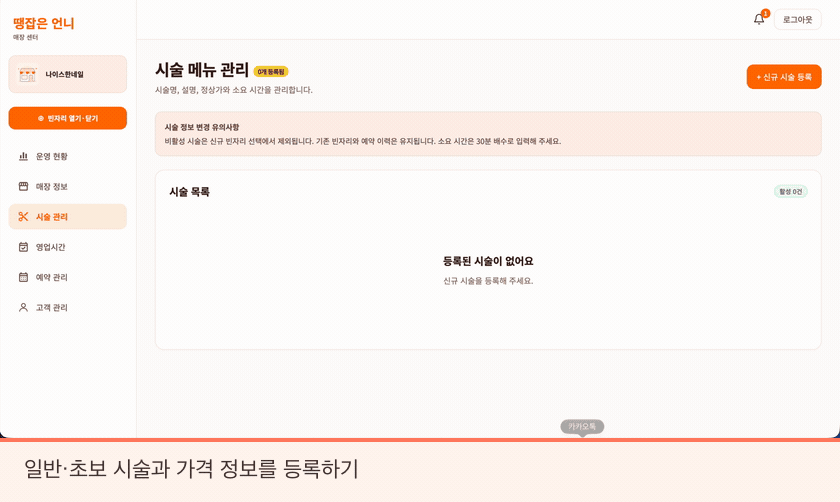</td>
    <td>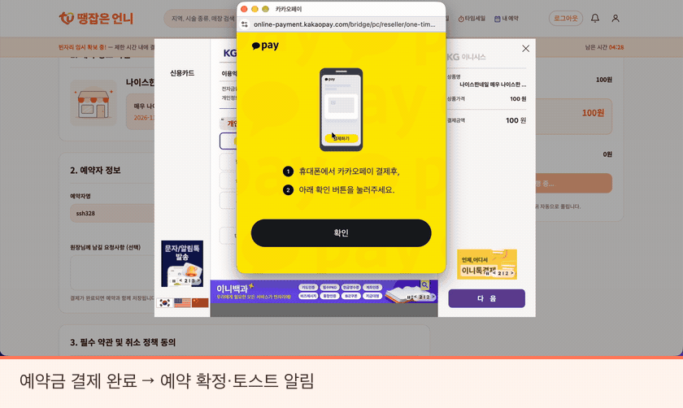</td>
  </tr>
</table>

<details>
<summary><strong>고객 취소·환불 견적 보기</strong></summary>

취소 전 환불 예정 금액과 정책을 확인하고, 취소 완료 결과를 안내합니다. 아래 금액은 해당 시연 조건의 결과입니다.

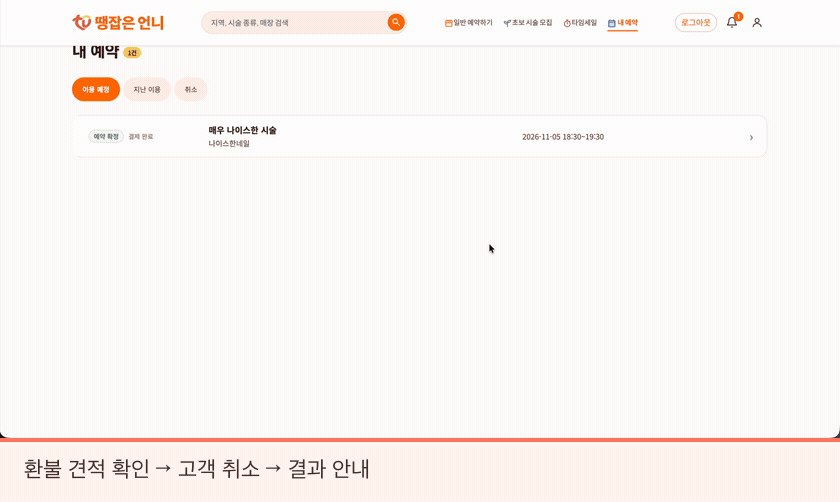

</details>

### 여러 화면으로 확인하는 핵심 시나리오

발표의 시연 순서와 동일하게 정리했습니다. **보라색으로 표시된 영역과 각 화면의 상태 변화**를 함께 확인해 주세요.

#### 01. 사용자 3명의 동시 예약

한 사용자가 결제 화면에 들어가면 다른 사용자는 대기 상태가 됩니다. 먼저 점유한 사용자가 이탈하면 다음 순서가 예약을 진행하고, 결제가 완료되면 나머지 사용자에게 마감을 안내합니다.

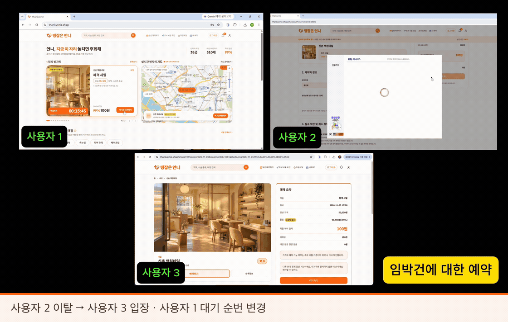

#### 02. 매장 가입 신청과 관리자 승인·거절

사업자 정보 확인·휴대폰 인증을 거쳐 신청한 매장을 관리자가 처리합니다. 승인 여부에 따라 문자 안내와 로그인 가능 상태가 달라집니다. GIF는 신청 이후 승인·거절 결과 구간을 발췌했습니다.

<details>
<summary><strong>관리자 처리와 매장 측 결과 함께 보기</strong></summary>

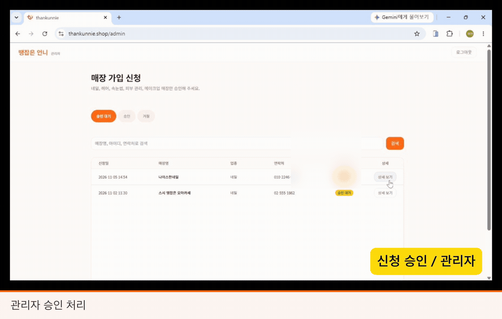

</details>

#### 03. 매장 취소 후 빈자리 재공개·알림

매장이 예약을 취소하고 시간을 다시 열면, 예약 고객에게는 취소 결과가 전달됩니다. 같은 시간에 알림을 신청한 고객은 빈자리 문자와 토스트 알림을 받고 다시 예약할 수 있습니다.

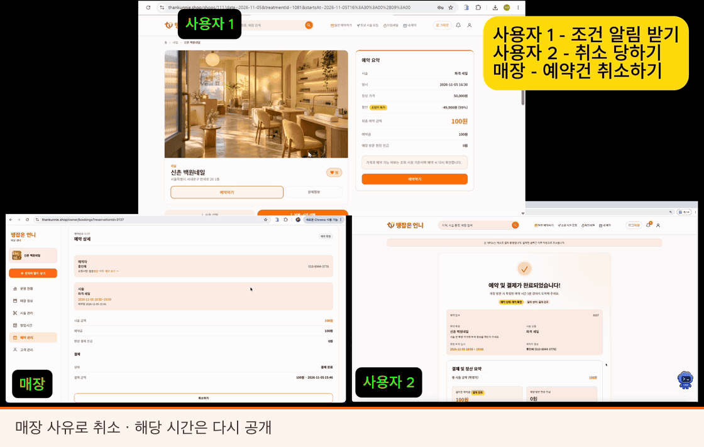

#### 04. 기존 예약이 있는 날의 휴무 설정

요일을 휴무로 바꿔도 기존 예약은 유지합니다. 필요한 경우 매장이 해당 예약을 별도로 취소하고, 고객과 매장에 취소 결과를 알립니다.

<details>
<summary><strong>휴무 설정과 기존 예약 처리 보기</strong></summary>

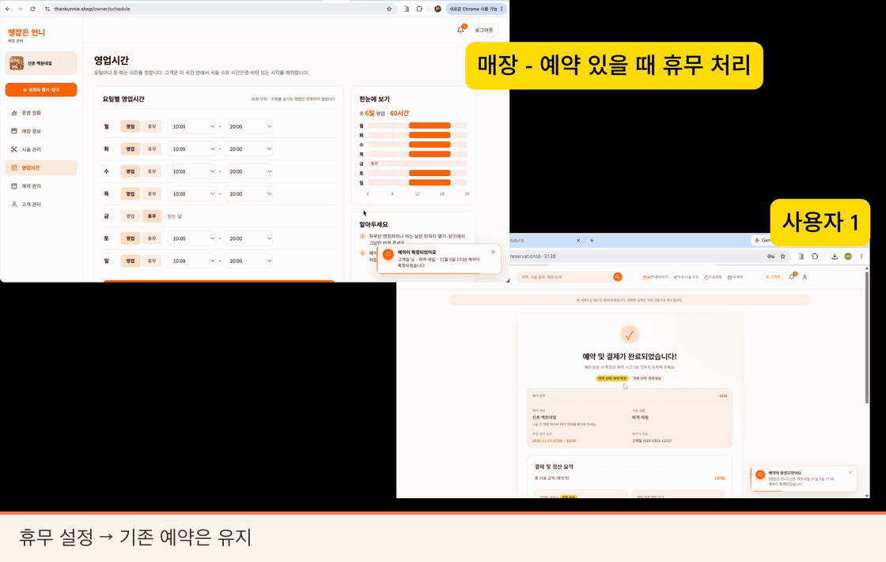

</details>

#### 05. 빈자리 열기·닫기

매장이 시간을 닫으면 고객도 해당 시간을 선택할 수 없습니다. 닫기 설정을 지우면 고객 화면에도 예약 가능한 시간이 다시 나타납니다.

<details>
<summary><strong>매장과 고객 화면의 가용 시간 변화 보기</strong></summary>

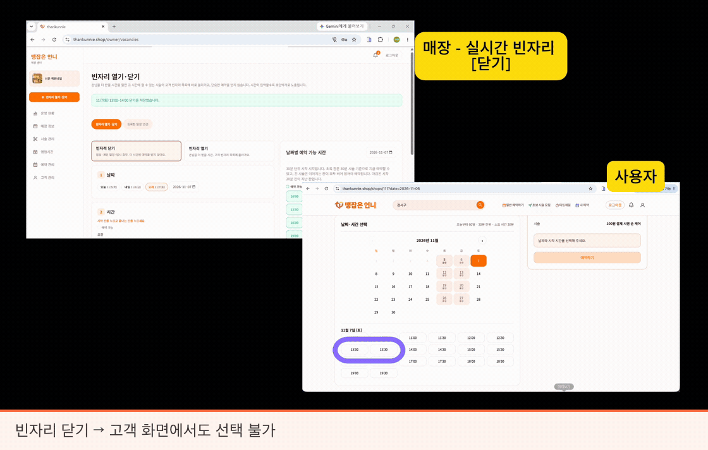

</details>

## 팀원과 담당 업무

**6명 전원이 풀스택으로 참여**했으며, 아래는 발표 자료에 정리한 주요 담당 영역입니다. 공통 기능 통합과 코드 리뷰는 함께 진행했습니다.

| 팀원 | 역할 | 주요 담당 업무 |
| --- | --- | --- |
| **[김서원](https://github.com/ironhamlab)**<br />[@ironhamlab](https://github.com/ironhamlab) | 팀장 · Full-stack · Infra | 취소·환불, 인증, 매장 대시보드, AWS 배포, Docker·Nginx·HTTPS, CI/CD |
| **[김명서](https://github.com/msk9912)**<br />[@msk9912](https://github.com/msk9912) | Full-stack | 매장·시술 관리, 이미지 업로드, 매장·시술 상세, 가입 시 유효성 검증 |
| **[김정현](https://github.com/cd081320)**<br />[@cd081320](https://github.com/cd081320) | 프론트엔드 파트장 · Full-stack | 예약·대기열, 결제 화면, 회원 상태, 프론트엔드 공통 구성 |
| **[박재현](https://github.com/parkJJae)**<br />[@parkJJae](https://github.com/parkJJae) | 백엔드 파트장 · Full-stack | 영업시간·가용 시간·가격, 관리자 기능, 백엔드 공통 구성 |
| **[송승혁](https://github.com/ssh328)**<br />[@ssh328](https://github.com/ssh328) | Full-stack | 찜, 문자, 알림 이벤트, SSE 서버·heartbeat |
| **[홍인혜](https://github.com/honginhye)**<br />[@honginhye](https://github.com/honginhye) | Full-stack | 메인, 빈자리 탐색, 지도·거리, 결제·결제 취소 |

GitHub 계정은 [저장소 기여자 목록](https://github.com/ironhamlab/thankunnie/graphs/contributors)과 커밋 작성 기록을 대조했습니다. 이름 또는 아이디를 누르면 해당 팀원의 GitHub 프로필로 이동합니다.

## 기술 스택

| 영역 | 기술 |
| --- | --- |
| Frontend | JavaScript, React 19, Vite 7, React Router 6, Zustand 5, Axios, SEED Design |
| Backend | Java 21, Spring Boot 3.5, Spring Security, Spring Data JPA, JWT, Gradle |
| Database | 운영 Oracle Database 21c XE / 기본 로컬·자동 테스트 H2 Oracle 호환 모드 |
| Infra | AWS EC2, Amazon S3, Docker Compose, Nginx, Let's Encrypt |
| CI/CD | GitHub Actions, GHCR, SSH 배포 |
| 외부 연동 | 카카오맵, 포트원 V1, Solapi, 국세청 사업자 정보 API |
| 품질·협업 | JUnit 5, JaCoCo, ESLint, Prettier, Swagger/OpenAPI, GitHub PR, Jira, Notion, CodeRabbit |

## 시스템 구성

### 아키텍처

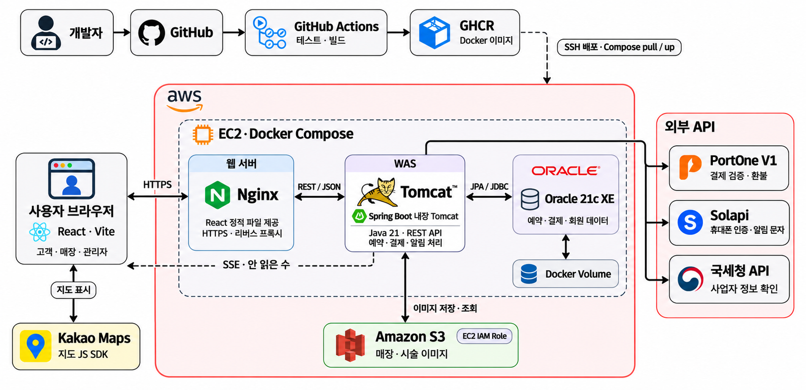

- EC2 한 대에서 **Nginx·프론트엔드, Spring Boot 백엔드, Oracle**을 Docker Compose로 운영했습니다.
- Nginx가 정적 파일을 제공하고 API를 백엔드로 프록시하며, 도메인과 HTTPS를 연결했습니다.
- 매장·시술 이미지는 S3에 저장하고 EC2 IAM 역할로 접근했습니다.
- 프론트엔드·백엔드 배포와 Oracle 구성을 나누고, Oracle 데이터는 별도 Docker 볼륨으로 보관했습니다.
- 서버·애플리케이션의 시간 기준은 **Asia/Seoul**로 맞췄습니다.

### CI/CD

```text
기능 브랜치 → dev 대상 PR → 변경 경로 감지 → BE 테스트 / FE 린트·빌드
                              ↓
                         리뷰 후 dev 병합
                              ↓
                  테스트 → 변경 서비스 이미지 빌드
                              ↓
                    GHCR 게시 → EC2 배포
                              ↓
                   HTTPS·정적 자산·API 응답 검증
                              ↓
               성공 상태 기록 / 실패 시 이전 이미지 복구 시도
```

- PR의 변경 경로에 따라 백엔드·프론트엔드 검증을 나누었습니다.
- `dev` 변경은 마지막 성공 배포와 비교하여 필요한 서비스 이미지를 빌드·배포하도록 구성했습니다.
- 배포 완료 전 프론트엔드 정적 자산과 API 라우팅을 검사하고, 실패 시 이전 이미지로 복구하도록 구현했습니다.
- DB 스키마는 자동 변경하지 않습니다. **이미지 복구와 DB 스키마 복구는 별도**이며 운영 DDL은 직접 적용했습니다.

### ERD

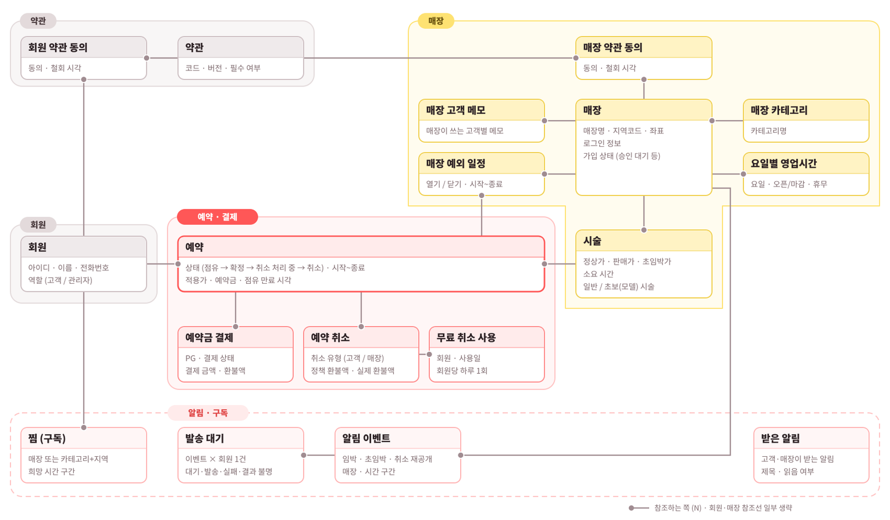

스키마 기준은 [`docs/erd/01_schema_ddl.sql`](docs/erd/01_schema_ddl.sql)입니다. 백엔드는 `ddl-auto: validate`로 스키마를 검증하며, 운영 Oracle에는 DDL을 자동 실행하지 않습니다.

## 구현에서 집중한 점

| 주제 | 구현 방향 |
| --- | --- |
| 같은 빈자리의 동시 예약 | 회원·매장 단위 잠금과 가용 시간 재검사로 중복 점유를 제어하고, 대기열에서 순서를 안내 |
| 예약·결제 상태 연결 | 임시 점유, 결제 검증, 예약 확정을 구분하고 중복 요청·만료 상황 처리 |
| 취소 이후 후속 처리 | 환불 정책을 분리하고 취소 완료 후 빈자리 재공개와 알림 흐름 연결 |
| 알림 대상 분리 | 관심 조건·회원·매장별 수신 대상을 구분하고 중복 발송 방지, SSE 연결 유지 처리 |
| 환경별 일관성 | 기준 DDL 공유, KST 시간 기준, 공통 응답·에러 코드, 환경변수 기반 외부 연동 |

> 현재 예약 대기열은 단일 서버 메모리를 사용합니다. 다중 서버 확장 시에는 대기열과 알림 연결 상태의 공유 설계가 필요합니다.

## 테스트와 검증

**발표 자료 기준 · 2026.11.06**

| 항목 | 결과 |
| --- | --- |
| 백엔드 자동 테스트 | **1,131개 통과** |
| JaCoCo 라인 커버리지 | **94.4%** |
| JaCoCo 분기 커버리지 | **85.5%** |
| 동시성 검증 | 예약·결제·취소의 중복 처리 시나리오 |
| 알림 검증 | 수신 대상 분리, 조회·읽음 권한, 구독 조건 매칭, 중복 발송 방지 |

커버리지는 설정·DTO·진입점·Lombok 생성 코드를 제외한 수치입니다. 자동 테스트에는 H2 Oracle 호환 모드와 외부 API Mock이 포함되며, 운영 환경 전체에 대한 성능·부하 검증 수치는 아닙니다.

<details>
<summary><strong>발표 당시 테스트 결과 보기</strong></summary>

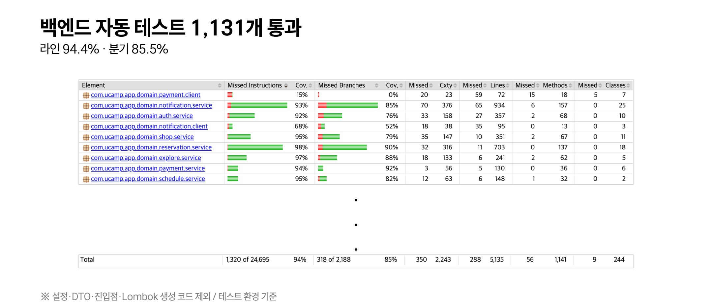

</details>

## 개발 일정과 협업

| 기간 | 진행 내용 |
| --- | --- |
| 10.19 ~ 10.20 | 주제 선정, 핵심 문제·대상 정의 |
| 10.21 ~ 10.22 | 기능·정책·역할 정리, 화면·ERD·개발 환경 구성 |
| 10.23 ~ 10.28 | 고객·매장 핵심 기능 개발 |
| 10.29 ~ 11.03 | 서비스 흐름 연동, 기능 보완·안정화 |
| 11.04 ~ 11.05 | 통합 QA, 오류 수정, 시연·발표 준비 |

- **Jira**로 작업과 이슈를 관리하고 **Notion**으로 정책·진행 내용을 공유했습니다.
- 기능 브랜치에서 작업한 뒤 PR로 리뷰·통합하고, `dev`를 개발 통합 브랜치로 사용했습니다.
- [`AGENTS.md`](AGENTS.md)에 AI 작업 지침을 정리하고 CodeRabbit 리뷰를 함께 활용했습니다.
- 자세한 협업 규칙은 [Git 가이드](docs/git-guide.md)와 [백엔드](docs/convention/BACKEND_CONVENTION.md)·[프론트엔드 컨벤션](docs/convention/FRONTEND_CONVENTION.md)에 정리했습니다.

## 로컬 실행

### 준비

Java 21과 Node.js 22가 필요합니다. 기본 로컬 실행은 **H2**를 사용하므로 Oracle을 먼저 설치할 필요는 없습니다.

저장소 루트에서 예시 설정을 복사합니다.

```bash
cp backend/src/main/resources/application-local.yml.example \
   backend/src/main/resources/application-local.yml
cp frontend/.env.example frontend/.env.local
```

AWS 없이 이미지 기능을 확인하려면 백엔드 실행 환경에 `SHOP_IMAGE_STORAGE=local`을 지정합니다. 지도·결제·문자·사업자 조회 기능은 각 서비스의 설정이 필요합니다. 실제 키는 로컬 설정 또는 실행 환경변수에만 입력합니다.

### 백엔드

```bash
cd backend
SHOP_IMAGE_STORAGE=local bash ./gradlew bootRun --args='--spring.profiles.active=local'
```

- API: `http://localhost:8080`
- Swagger: `http://localhost:8080/swagger-ui/index.html`
- H2 로컬 프로필은 기준 DDL과 초기·시연 데이터를 시작 시 적용합니다.
- 국세청 가짜 조회가 필요한 경우 로컬 설정의 `nts.fake: true`를 사용할 수 있습니다. 이 설정은 로컬 프로필 전용입니다.

### 프론트엔드

별도 터미널에서 실행합니다.

```bash
cd frontend
npm ci
npm run dev
```

- 화면: `http://localhost:5173`
- 프론트 API 주소와 공개 연동 값은 `frontend/.env.local`에 설정합니다.
- `VITE_` 값은 브라우저에 포함되므로 서버 비밀 키를 넣지 않습니다.

### 검증 명령

```bash
# 백엔드 테스트 + JaCoCo 리포트 생성
cd backend
bash ./gradlew test

# 프론트엔드 검증: 저장소 루트의 별도 터미널에서 실행
cd frontend
npm run lint
npm run build
```

JaCoCo HTML 리포트는 테스트 실행 후 `backend/build/reports/jacoco/test/html/index.html`에서 확인할 수 있습니다.

<details>
<summary><strong>Oracle로 확인하려면</strong></summary>

루트의 `docker-compose.yml`은 로컬 Oracle 확인용입니다. 기본 H2 실행과 별도로 사용하며, 운영의 Oracle 21c XE와 로컬 Oracle Free 간 버전 차이가 있습니다.

1. 저장소 루트에서 `docker compose up -d`를 실행합니다.
2. 백엔드 datasource를 `application-local.yml.example`의 Oracle 예시에 맞춥니다.
3. 해당 DB 계정에 기준 DDL과 필요한 초기 데이터를 직접 적용합니다.
4. 이후 백엔드를 실행합니다. Oracle에서는 애플리케이션이 테이블을 자동 생성하지 않습니다.

</details>

## 저장소 구조

```text
thankunnie/
├── backend/                 # Spring Boot API 및 자동 테스트
├── frontend/                # React 고객·매장·관리자 화면
├── infra/                   # 운영 Compose, 배포·검증 스크립트
├── .github/
│   ├── workflows/           # CI/CD
│   └── scripts/             # JaCoCo 요약 등 자동화
├── docs/
│   ├── api/                 # API 명세
│   ├── convention/          # BE·FE 컨벤션
│   ├── design/              # 화면 구현 안내
│   ├── erd/                 # 기준 DDL·초기·시연 DML
│   └── readme/              # README 이미지
├── docker-compose.yml       # 로컬 Oracle
└── AGENTS.md                # AI 작업 지침
```

## 더 알아보기

| 문서 | 내용 |
| --- | --- |
| [인증·가입 API](docs/api/auth.md) | 로그인, 회원·매장 가입 및 사업자 검증 |
| [예약 API](docs/api/reservations.md) | 예약·대기열 관련 명세 |
| [빈자리 탐색 API](docs/api/C-01-vacancy-search.md) | 탐색 조건과 응답 |
| [알림함 API](docs/api/notification-inbox.md) | 알림 조회·읽음·실시간 연결 |
| [매장 승인 API](docs/api/admin-shop-applications.md) | 관리자 승인·거절 |
| [공통 에러 코드](docs/api/error-codes.md) | 도메인별 오류 응답 |
| [기준 DDL](docs/erd/01_schema_ddl.sql) | 테이블·시퀀스·제약조건 |

## 앞으로의 확장

선호 조건·이용 이력을 반영한 추천, 가족·지인 대리 예약, 방문 고객 리워드를 확장 방향으로 정리했습니다. 수익화는 신규 고객 유입 수수료·매장 관리 구독·선택형 홍보 상품을 제안했으며, **현재 구현 기능에는 포함되지 않습니다.**

---

<p align="center"><strong>원하는 시간에 땡잡는 예약, 땡잡은 언니.</strong><br />U-CAMP 2조 · 2026</p>
